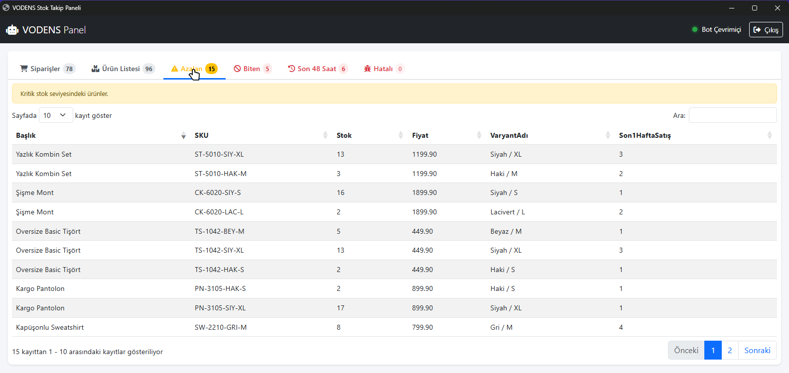
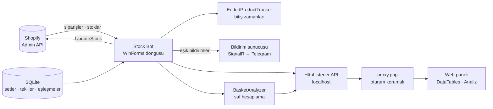
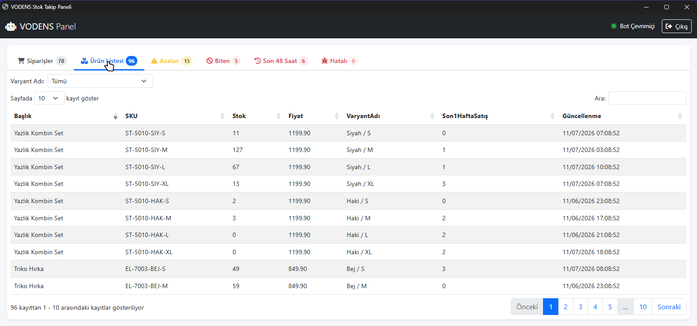
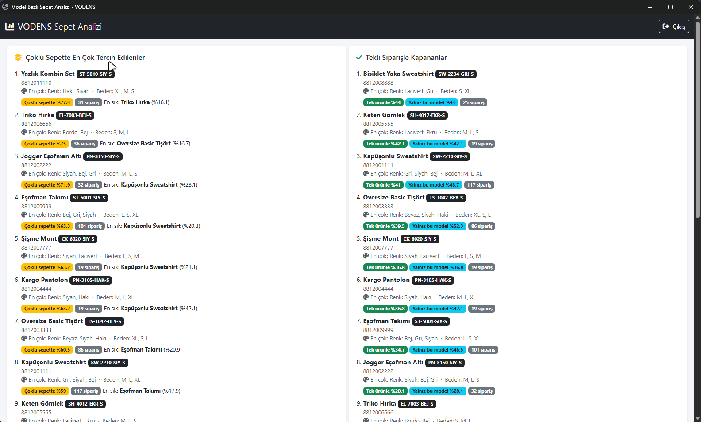
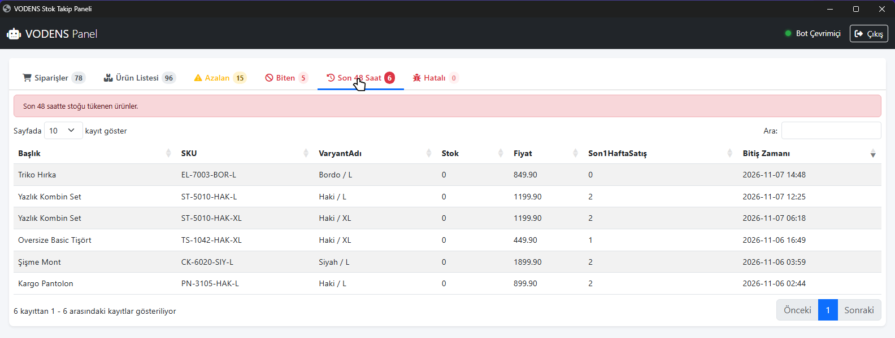

# VODENS Stock Bot — Set Ürün Stok Senkronizasyonu ve Sepet Analizi

**Set (takım) ürünlerin stoğunu içindeki tekil ürünlerle otomatik eşitleyen, bitmek üzere/biten ürünleri Telegram'dan bildiren ve "hangi modeller birlikte satın alınıyor?" sorusunu cevaplayan sepet analizi panelli Shopify stok botu.**

-lightgrey)

> **30 saniyede:**
> - **Problem:** Bir "set" ürün (ör. alt-üst takım) satılınca içindeki tekil ürünlerin stoğu Shopify'da kendiliğinden düşmüyor, tekil ürün bitince de set satılmaya devam ediyordu → olmayan ürünün satışı.
> - **Çözüm:** Sipariş geldikçe set ve tekil ürün stoklarını kurala göre (`min()`) eşitleyip Shopify'a yazan bot; stok eşik bildirimleri; tarayıcıdan izlenen web paneli.
> - **Ek değer:** Siparişlerden **model bazlı sepet analizi** — birlikte alınan modeller, renk/beden çiftleri, en çok satan varyantlar; CSV dışa aktarım.

  

<b>English summary</b>

A Shopify stock bot for bundle ("set") products. When a set is ordered, it recalculates the stock of the set and its single items (set stock = min of its components) and writes the result to Shopify; it sends threshold notifications (running low / sold out / negative) and a real-time "sold out in the last 48 hours" alert. A local HttpListener API feeds a session-protected PHP + DataTables web panel, which also hosts a model-level basket analysis (frequently-bought-together models, colour/size pairs, top variants, CSV export). Includes robust 429 rate-limit handling. Source is private.

---

## Problem

Mağazada aynı ürün hem tek başına hem de set içinde satılıyordu. Shopify bu ilişkiyi yerel olarak bilmediği için:
- Set satılınca tekil ürünlerin stoğu düşmüyordu.
- Tekil ürün bitince set hâlâ "stokta" görünüyordu.
- Hangi ürünlerin bitmek üzere olduğu, ancak satış kaçırıldıktan sonra fark ediliyordu.

## Çözüm

- **Set mantığı:** Setler, tekil ürünler ve eşleşmeleri SQLite'ta. Set siparişi geldiğinde bileşen stokları yeniden hesaplanır ve Shopify'a yazılır.
- **Bildirim eşikleri:** Stok 1–20 "bitmek üzere", 0 "bitti", negatif "hatalı". Son bir haftada satışı olmayan ürünler gürültü yapmasın diye bildirilmez.
- **Son 48 saatte bitenler:** Stok sıfıra geçiş anları kaydedilir; yalnızca **yeni** biten ve satışı olan ürünler anlık bildirilir (ilk çalıştırmada sessiz başlangıç, yeniden stoklananlar listeden düşer).
- **Web paneli:** Tarayıcı botla doğrudan konuşmaz; oturum korumalı PHP proxy üzerinden yerel API'ye gider. 5 saniyede bir veri sürümü kontrol edilir, değiştiyse tablolar tazelenir.

## Sepet analizi

Siparişler ürün (model) bazında analiz edilir:
- Model başına sipariş sayısı, toplam adet, beden dağılımı,
- **Birlikte satın alınan modeller** ve en sık birlikte alınan model,
- Renk/beden çiftleri ve **en çok satan ilk 3 renk ve beden**,
- Eşleşmeyen satırların ayrı listesi (veri kalitesi görünürlüğü),
- Filtreler, sıralama, model detay ekranı ve CSV dışa aktarım.

Hesaplama çekirdeği (`BasketAnalyzer.Compute`) yan etkisizdir; sentetik siparişlerle doğrulanıp canlı API verisiyle test edildi (ör. 1 günlük 4.578 satır → 66 model, eşleşmeyen 0).

## Mühendislik kararları

- **429 hatasının kök nedeni bulundu.** Yeniden denemede aynı `HttpRequestMessage` tekrar gönderildiği için "istek zaten gönderildi" istisnası oluşuyordu — bu, stok yazımında da gizli bir hataydı. Çözüm: yeniden denemenin her seferinde yeni istek üreten bir **fabrika** (`Func<HttpRequestMessage>`) alması, `Retry-After`'a uyulması ve sayfalar arası bekleme.
- **Analiz ile botun aynı token'ı paylaşması.** 30 günlük analiz ~180 sayfa istek demekti; oran sınırına dayanıklılık için sayfa bazlı deneme ve bekleme stratejisi.
- **CDN bağımsızlığı.** Panelin dil dosyası yerelleştirildi; CDN engeli/CORS paneli bozmasın.
- **Geriye uyumlu şema göçü.** Yeni analiz kolonları mevcut SQLite veritabanına güvenli `ALTER TABLE` göçleriyle eklendi.

## Teknoloji yığını

| Alan | Teknolojiler |
|---|---|
| Bot | C#, .NET Framework 4.8, WinForms |
| Shopify | REST Admin API, `HttpClient`, oran sınırı yönetimi |
| Veri | SQLite |
| Yerel API | `HttpListener` |
| Web paneli | PHP (XAMPP), jQuery DataTables |
| Bildirim | SignalR istemcisi → Telegram köprüsü |

## Ekran görüntüleri

| | |
|---|---|
|  **Ürün listesi (stok + haftalık satış)** |  **Model bazlı sepet analizi** |
|  **Son 48 saatte bitenler** | |

> Görsellerdeki ürünler, stoklar, siparişler ve müşteri adları kurgusaldır. Bot, izole bir demo kopyasında Shopify yerine 127.0.0.1 üzerinde çalışan sahte bir yerel API'ye bağlanarak çalıştırılmıştır; Telegram ve bildirim sunucusu bağlantıları kapatılmış, mağazada hiçbir stok değişmemiştir.

## Rolüm

Tek geliştirici: bot, veri modeli, web paneli, analiz modülü ve hata ayıklama.

## Kaynak kodu hakkında

Bu depo bir **vaka çalışmasıdır**; kod ticari bir işletmeye ait olduğu için paylaşılmamaktadır.

📫 **İletişim:** [GitHub profilim](https://github.com/furkan-karapinar)
